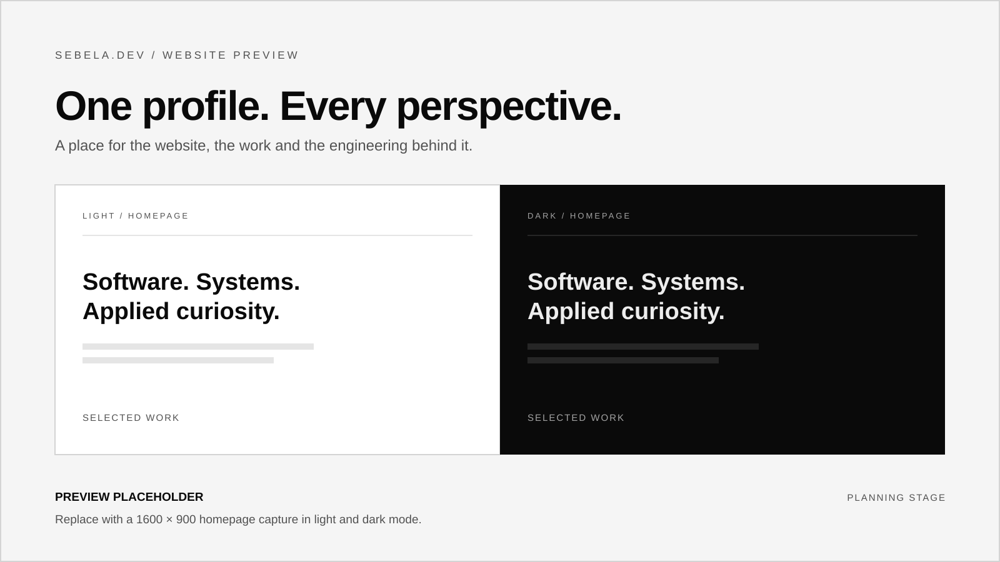
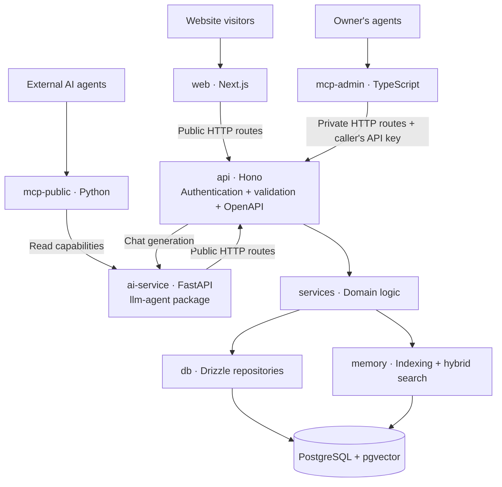

<div align="center">

# sebela.dev

**One profile. A website, a CV, an AI Roadmap — and the tools to ask about all of it.**

The open-source engineering behind Petr Šebela's next professional website.

[](.plan/03-web/prd.md)
[](https://github.com/sebelapetr/sebela.dev/actions/workflows/ci.yml)
[](LICENSE)

[The idea](#the-idea) · [Architecture](#architecture) · [AI & MCP](#ai--mcp) · [Roadmap](#roadmap) · [Getting started](#working-on-the-project) · [Documentation](#documentation)



<sub>A professional profile for people. Structured public knowledge for agents.</sub>

</div>

> [!NOTE]
> **Website stage.** This checkout contains the specifications, architecture decisions and agent instructions, the development harness, the foundation (a pnpm and Turborepo workspace with shared lint, TypeScript and Prettier configuration, a local PostgreSQL with pgvector and a separate database and role per worktree, Git hooks, guardrail checks and CI) and the backend: the Hono content API with its profile domain, API-key authentication, media uploads, the assembled CV data, OpenAPI, the generated TypeScript client and a fictional demo seed, and the website: every presentation page, the CV and a chat interface that answers from prepared, deterministic scenarios instead of a model. The AI Roadmap, the real assistant, retrieval and both MCP servers are **planned** and arrive in later phases; sections describing them say what they are designed to do, not what runs today. The replacement for sebelapetr.cz will launch after all delivery phases are complete.

<details>
<summary><strong>For the owner: replace the preview image</strong></summary>

Add a **1600 × 900 px** PNG or WebP to `docs/images/`, for example `readme-preview.webp`, and update the image path above.

Use a side-by-side capture of the homepage in **light and dark mode**, showing the hero and the beginning of Selected work. Keep the text readable, crop out browser chrome and use the fictional demo profile for a reusable repository screenshot. Follow the monochrome direction in [the design guide](docs/design.md).

The current SVG is an intentional placeholder. Remove this note when the real preview is ready.

</details>

## The idea

A professional website has several readers: clients looking for help, employers evaluating experience, and increasingly AI agents looking for reliable facts. This project gives them different ways into the same structured content.

**Store a fact once. Reuse it everywhere.** PostgreSQL is the canonical source for the website, the CV page, the AI Engineering Roadmap, the assistant and both Model Context Protocol (MCP) servers. Content updates go through the API and appear without a redeploy.

| Surface                    | What it is designed to offer                                                                                                      |
| -------------------------- | --------------------------------------------------------------------------------------------------------------------------------- |
| **Professional website**   | Selected work, experience, services and clear paths for clients and employers.                                                    |
| **CV**                     | A print-friendly page built from the same profile data, alongside a separately prepared and uploaded PDF.                         |
| **AI Engineering Roadmap** | Learning areas, modules, resources, a diary with time tracking, books and events.                                                 |
| **Grounded assistant**     | Questions answered from public profile data, with sources, rich content blocks and an explicit fallback when evidence is missing. |
| **Two MCP servers**        | A public read-only interface for external agents and a secured interface for the owner's content-management agents.               |

The repository is part of the portfolio too: architecture decisions, testing policy and the development workflow are open for inspection.

## Architecture

**The API is the trust boundary.** Every client reaches content through HTTP. Only the API's backend layers access the database. The diagram shows the target design. Today the API with its services, database package, contracts and generated TypeScript client and the website exist; the AI service, retrieval and both MCP servers are planned.



- **One contract across languages.** OpenAPI drives generated clients; Zod provides API validation and shared TypeScript schemas. The TypeScript client is generated and drift-checked in CI today; the Python client of phase 7 is generated from the same committed `openapi.json` ([`packages/api-client`](packages/api-client/AGENTS.md#python-consumers-phase-7-not-scaffolded)).
- **Authenticated content writes.** Private API routes verify API keys. Keys stay server-side; the public assistant has no content-write credentials or tools.
- **A bounded chat exception.** Public chat routes may create, continue and delete the caller's own conversation. The API checks ownership, limits and budget.
- **Rebuildable retrieval.** The search index is derived from canonical content in PostgreSQL.
- **Content outside git.** Development uses a fictional demo seed. Real profile content is loaded privately and maintained through the API; media lives in object storage.

Read the [architecture](docs/architecture.md), [package boundaries](docs/repository-structure.md) and [decision records](docs/decisions/README.md) for the reasoning and tradeoffs.

### Stack

| Area             | Technology                                                                 | Status                                                                                                 |
| ---------------- | -------------------------------------------------------------------------- | ------------------------------------------------------------------------------------------------------ |
| Workspace        | TypeScript, pnpm workspaces, Turborepo, ESLint, Prettier                   | Delivered                                                                                              |
| Website          | Next.js, Tailwind CSS v4, shadcn/ui on Base UI, Geist, Lucide              | Delivered; the chat answers from prepared scenarios until phase 7                                      |
| API & contracts  | Hono, Zod, OpenAPI, generated clients                                      | Delivered; the TypeScript client is generated, the Python client follows in phase 7                    |
| Data & retrieval | PostgreSQL, Drizzle, pgvector, vector similarity + full-text search        | PostgreSQL with pgvector and Drizzle delivered; retrieval planned (phase 6)                            |
| AI service       | Python, FastAPI, LangGraph, LangChain model integrations, Pydantic         | Planned (phase 7)                                                                                      |
| Verification     | Vitest, Playwright, pytest, Promptfoo; code/model graders and human review | Vitest, Playwright and Node's test runner delivered; the rest planned                                  |
| Observability    | Langfuse for AI traces, cost and scoring                                   | Planned                                                                                                |
| Delivery         | Docker Compose, GitHub Actions, deployment to a VPS                        | Compose for local Postgres, the API and the website, their images and CI delivered; deployment planned |

The visual direction is editorial and monochrome: strong typography, generous whitespace, light and dark themes. See [design](docs/design.md).

## AI & MCP

> [!NOTE]
> **Planned.** Nothing in this section is implemented yet. The admin MCP server arrives in phase 5, retrieval in phase 6, and the assistant and public MCP server in phase 7.

### How an answer is produced

The browser reaches the assistant through the website and API. The API owns conversations and access controls; the Python service produces answers.

1. **Check access and cost.** The API verifies conversation ownership, applies rate limits and bot checks, and checks the available budget before a model call.
2. **Guard the input.** A small model checks for off-topic requests, manipulation and abuse.
3. **Find evidence.** The generating model chooses structured tools for exact facts and hybrid search for open questions. Both read public data through the API.
4. **Validate and stream.** Deterministic checks validate the output structure, sources, links and exploration status before the answer is streamed through the API to the website.

Answers include typed blocks such as experience, services, roadmap items and sources. Missing evidence leads to an explicit “I don't know” and a contact option. Built, tested and designed work must retain its recorded status.

Langfuse receives redacted traces; stored conversations are scored afterwards and sampled for human review. The package runs three stages: Security Gateway, Main Agent and deterministic Output Guard. Context, retries, concurrency, cancellation and spend are bounded per request. Model and embeddings choices are deferred to their implementation phases and evaluated before adoption.

### Two servers, two responsibilities

|                    | Public MCP                                                                        | Content-management MCP                                    |
| ------------------ | --------------------------------------------------------------------------------- | --------------------------------------------------------- |
| **App**            | `apps/mcp-public`                                                                 | `apps/mcp-admin`                                          |
| **Audience**       | External AI agents                                                                | The owner's agents                                        |
| **Access**         | Public, read-only, rate limited                                                   | Secured; caller's API key forwarded to the API            |
| **Purpose**        | Read profile, experience, services and learning activity; search public knowledge | Add and update content through private API routes         |
| **Implementation** | Python; calls FastAPI read capabilities backed by the shared agent package        | TypeScript; reuses contracts and the generated API client |

Connection URLs and client configuration will be added when the servers are implemented.

### Retrieval without a separate vector service

Public content is split into chunks, embedded and indexed with pgvector in the same PostgreSQL instance. Search combines vector similarity and full-text matching. Relevance is measured with questions that have known sources, and the index can be rebuilt from the original content.

## Roadmap

The phases organise implementation; they are not separate public releases. Specifications are drafts until approved. The harness (phase 00), the foundation (phase 01), the API and database (phase 02) and the website (phase 03) are delivered; phases 04 to 08 are planned.

| Phase                       | Deliverable                                                                       | Specification                                                                      |
| --------------------------- | --------------------------------------------------------------------------------- | ---------------------------------------------------------------------------------- |
| **00 · Overview & harness** | Project design, documentation, agent rules and the unattended development harness | [Overview](.plan/00-overview/prd.md) · [Harness](.plan/00-overview/harness-prd.md) |
| **00 · Trial**              | A disposable dry run of the orchestration and review workflow                     | [Trial](.plan/00-trial/prd.md)                                                     |
| **01 · Foundation**         | Monorepo tooling, isolation, guardrails, Docker skeleton and CI                   | [Foundation](.plan/01-foundation/prd.md)                                           |
| **02 · API & database**     | Profile domain, OpenAPI, authentication and fictional demo data                   | [API & database](.plan/02-api-db/prd.md)                                           |
| **03 · Website**            | Presentation pages, CV, design system and a chat UI backed by prepared answers    | [Website](.plan/03-web/prd.md)                                                     |
| **04 · AI Roadmap**         | Learning domain, diary, books, events and roadmap pages                           | [AI Roadmap](.plan/04-ai-roadmap/prd.md)                                           |
| **05 · Admin MCP**          | Secured content-management tools and content skills                               | [Admin MCP](.plan/05-mcp-admin/prd.md)                                             |
| **06 · Retrieval**          | Chunking, embeddings and measured hybrid search                                   | [Retrieval](.plan/06-rag-memory/prd.md)                                            |
| **07 · LLM agent**          | Grounded chatbot, public MCP and conversation controls                            | [LLM agent](.plan/07-llm-agent/prd.md)                                             |
| **08 · Delivery**           | Verified image builds, VPS deployment, backups, rollback and launch               | [Delivery](.plan/08-delivery/prd.md)                                               |

## Working on the project

What you can run today is the workspace, its quality checks, the local database, the worktree tooling, the content API with its demo data and the website. The assistant and the MCP servers do not exist yet.

### Prerequisites

| Tool                                | Version                                                                                                                                 |
| ----------------------------------- | --------------------------------------------------------------------------------------------------------------------------------------- |
| Git                                 | Any current version with `git worktree`                                                                                                 |
| [Node.js](https://nodejs.org/)      | 26, the current LTS line (`.nvmrc`). Installation fails on another version.                                                             |
| [pnpm](https://pnpm.io/)            | 12.21.0 (`packageManager` in `package.json`). Install it directly, for example `npm install --global pnpm@12.21.0`; see the note below. |
| Docker with the Compose plugin (v2) | A version that supports `docker compose up --wait`                                                                                      |

An older global pnpm, such as pnpm 10, cannot switch itself to the native pnpm 12 executable and fails instead, so install pnpm 12.21.0 itself. Corepack is not needed.

### 1. Install

```sh
git clone https://github.com/sebelapetr/sebela.dev.git
cd sebela.dev
pnpm install --frozen-lockfile
```

Installation needs no configuration. It installs exactly what `pnpm-lock.yaml` records and enables the Git hooks that format and lint staged files and check commit messages ([local hooks](docs/git-workflow.md#local-hooks)). In a checkout installed before, `pnpm run prepare` enables the hooks.

### 2. Prepare local configuration

```sh
cp .env.example .env
```

Then replace the placeholder `POSTGRES_PASSWORD` in `.env` with a local password of your own, and set `DATABASE_USER` and `DATABASE_PASSWORD` to the role the main checkout's code connects as: no script creates one for it, so it uses `POSTGRES_USER` and that password. `.env.example` documents every setting; its other values are the main checkout's ports, the Postgres address and port and the user and database names. Compose reads `.env` next to `compose.yaml`; a variable set in your shell takes precedence. Environment files are ignored by Git — never commit them.

### 3. Start the infrastructure

```sh
docker compose up --detach --wait
```

This one command starts PostgreSQL 18 with pgvector and returns when the service is healthy. Run it in the main checkout: the stack has a fixed project name, so the main checkout and every worktree share this one container, each with its own database. `docker compose down` stops it and keeps the data; `docker compose down --volumes` deletes the data as well.

To run the API and the website in containers as well, from the main checkout:

```sh
pnpm stack:up                                  # build the images, migrate, then start the API and the website
pnpm stack:seed                                # load the fictional demo seed (explicit, never automatic)
pnpm --silent stack:api-keys create my-laptop  # print the first API key once; store it yourself
pnpm stack:down                                # stop and remove the API and website containers; Postgres keeps running
```

`stack:up` starts a one-off migration service once Postgres is healthy, the API only after the migrations succeeded and the website once the API is healthy; a failed migration keeps the API down. The website is published on `WEB_HOST` and `WEB_PORT` and the API on `API_HOST` and `API_PORT`; inside the Compose network the website reads the API by its service name, and pages name stored images only by the website's own `/media/<file>`. Running `stack:up` again applies only new migrations; neither a start nor a restart seeds or resets content. Uploaded media live in the volume `api-media` and survive restarts. To stop everything, Postgres included, run `docker compose --profile api --profile web down` (a plain `docker compose down` leaves the API and the website running); add `--volumes` only to delete the data and the media. The API and the website run in containers or on the host (`pnpm --filter @sebela/api start`, `pnpm --filter @sebela/web start`), not both: they publish the same ports. Worktrees always use the host. The images hold code only, and the API's also the demo seed; personal content is loaded from a folder outside the repository at run time. Details: [`apps/api/AGENTS.md`](apps/api/AGENTS.md#container-stack) and [`apps/web/AGENTS.md`](apps/web/AGENTS.md#container).

### 4. Run the quality checks

```sh
pnpm lint       # ESLint, import boundaries and the hard-coded configuration check
pnpm typecheck
pnpm test       # package tests, harness tests and check tests
pnpm build
```

CI runs the same tasks on every pull request (`pnpm ci:root`, then `pnpm ci:affected` for the packages a change affects), plus end-to-end runs of the worktree databases and of the worktree backend setup against a disposable Postgres (jobs `Worktree database lifecycle` and `Worktree backend setup`) smoke checks of the containerised API stack and of two complete stacks with the website side by side, and the website's browser tests. You can run them yourself with Docker: `node harness/worktree-databases.e2e.mjs`, `node harness/worktree-backend.e2e.mjs`, `pnpm test:api-stack` and `pnpm test:web-stack`; each removes its containers, volumes and images at the end. Details: [testing](docs/testing.md).

### 5. Work in an isolated worktree

Code changes happen in a worktree per branch, never in the main checkout. With the infrastructure running, from the main checkout:

```sh
node harness/worktree.mjs create feat/12-profile-api --base master   # prints the worktree path
node harness/worktree.mjs list                                       # slots in use
```

- **Isolation.** The worktree takes the lowest free slot (1 to 9) and gets its own database in the shared Postgres, named after its folder (`wt_feat_12_profile_api_<hash>`), and its own database role of the same name. The role owns that database, may create temporary databases for tests and cannot connect to another worktree's database. Its ports are the main checkout's ports plus ten times the slot, so its ports, its database and its credentials are its own; the Postgres container is shared.
- **Generated configuration.** `create` writes the worktree's `.env.local` itself: `WORKTREE_SLOT`, the ports of its slot, `DATABASE_NAME`, `DATABASE_USER` and `DATABASE_PASSWORD` with a random password it never prints, `STORAGE_WORKTREE` (its own storage folder) and `STORAGE_PUBLIC_BASE_URL` (its own API's file route). The base ports come from your process environment and otherwise from `.env.example`. Running `create` again reuses the slot, the database and the password and never overwrites an existing `.env.local`; delete the file and run `create` again to regenerate it, with a new password for the role. The Postgres superuser password stays in the main checkout's `.env`.
- **Ready to work.** `create` then installs the worktree's dependencies, applies its migrations, prepares its storage folder and loads the fictional demo seed into its empty profile, so its API serves content right away. A failing stage stops `create` with the stage's name and keeps the worktree; run `create` again to retry. An older `.env.local` without `STORAGE_WORKTREE` is never changed: delete it and run `create` again.
- **Running setup again.** `create` on an existing worktree applies pending migrations and reuses its storage folder, but does not seed a profile that already holds content, so edits are kept. To refresh the content from the seed on purpose, run `pnpm --silent --filter @sebela/api seed` in the worktree; it overwrites the records the seed names. Details: [worktree backend setup](docs/repository-structure.md#worktree-backend-setup).
- **Reading configuration.** Code reads ports, hosts and database names from the process environment and fails when one is missing. Load `.env.local` into the process (for example `node --env-file=.env.local …`) instead of copying values out of it. Coding agents never open or print real environment files; they may edit only the `.env.local` of the worktree they work in ([permissions](docs/permissions.md)).

Remove the worktree when its branch is done:

```sh
node harness/worktree.mjs remove feat/12-profile-api --delete-branch
```

Removal first removes the worktree's storage folder, then drops its database, every temporary database its role still owns and the role, then removes the worktree and frees its slot. When the storage folder cannot be removed, nothing else is removed. It refuses uncommitted work unless you pass `--force`, needs the running Postgres, and only ever drops a database or role it created for that worktree. Slots, ports and databases in detail: [ports and worktree isolation](docs/repository-structure.md#ports-and-worktree-isolation).

### 6. Use the API on the host

In a worktree (or the main checkout with its `.env`), the backend commands read the process environment, then `.env.local`, `.env` and `.env.example`; each builds what it runs first. A worktree created by `create` is already migrated and seeded: `db:migrate` then only applies new migrations, and `seed` is optional and resets the records the seed names.

```sh
pnpm --filter @sebela/db db:migrate                          # migrations are separate; the API never migrates
pnpm --silent --filter @sebela/api seed                      # load the fictional demo seed again (overwrites what it names)
pnpm --silent --filter @sebela/api api-keys create my-agent  # prints the key once; only its hash is stored
pnpm --filter @sebela/api start                              # or `dev` to watch the sources
```

Public reads need no key; every write is a private route and needs the key as a bearer token, never in the URL. In these examples `API_HOST` and `API_PORT` stand for the checkout's own values and `API_KEY` for the printed key:

```sh
curl "http://$API_HOST:$API_PORT/v1/experiences"
curl -X POST "http://$API_HOST:$API_PORT/v1/topics" -H "Authorization: Bearer $API_KEY" \
     -H 'Content-Type: application/json' -d '{"slug":"evals","name":"Evals","position":9}'
curl -X POST "http://$API_HOST:$API_PORT/v1/media" -H "Authorization: Bearer $API_KEY" -F 'file=@cv.pdf;type=application/pdf'
curl -X PATCH "http://$API_HOST:$API_PORT/v1/person" -H "Authorization: Bearer $API_KEY" \
     -H 'Content-Type: application/json' -d '{"cvPdfId":"<media id>"}'
curl "http://$API_HOST:$API_PORT/v1/cv"
pnpm --silent --filter @sebela/api api-keys list             # metadata only; `revoke <id>` takes effect on the next request
```

The interactive reference is served at `/reference`, the document at `/openapi.json`; every route, its access and its errors are listed in [`apps/api/AGENTS.md`](apps/api/AGENTS.md#http-behaviour).

- **Two kinds of CV.** `GET /v1/cv` is CV _data_, assembled from the stored profile on every request; the website will render the CV page from it. The CV _PDF_ is a separate file you prepare yourself, upload with `POST /v1/media` and attach as the person's `cvPdfId`. The API never generates or updates the PDF, so it can differ from the data until you upload a new one.
- **Generated clients.** `pnpm generate:api-client` exports the OpenAPI document into `packages/api-client/src/generated/` and regenerates the typed TypeScript client; `pnpm check:api-client`, run by CI on every change, fails when the committed files differ. A Python client (phase 7) is generated from the same committed `openapi.json`, without the TypeScript toolchain ([`packages/api-client`](packages/api-client/AGENTS.md#python-consumers-phase-7-not-scaffolded)).
- **Storage without cloud credentials.** The default `STORAGE_DRIVER=local` keeps uploads on local disk and is served by the API itself; tests, CI and every command above need no Bunny credentials. The `STORAGE_BUNNY_*` settings are optional and only needed with `STORAGE_DRIVER=bunny-s3` ([Bunny Storage](docs/architecture.md#bunny-storage)).
- **Cleanup is for development only.** `node harness/worktree.mjs remove` drops one worktree's databases, role and storage folder, and `pnpm --silent --filter @sebela/api storage remove <worktree>` removes only that storage folder. `pnpm stack:down` removes the API containers and keeps every database, while `docker compose --profile api down --volumes` deletes the shared Postgres volume, with every checkout's and worktree's database, and the media volume. `storage` refuses `STORAGE_ENVIRONMENT=production` and folders it does not own, and no command resets or deletes production content; production safety comes from backups ([release workflow](docs/release-workflow.md)).

### 7. Run the website on the host

With the API of the same checkout running (step 6), in a second terminal:

```sh
pnpm --filter @sebela/web dev        # development server on WEB_HOST and WEB_PORT
pnpm --filter @sebela/web build      # needs neither the API nor any setting
pnpm --filter @sebela/web start      # serve the build
pnpm --filter @sebela/web test       # unit tests (Vitest)
pnpm test:e2e                        # browser tests with every build they need, as in CI
```

The website reads content only through the public API routes and never holds an API key. A page whose content is missing shows a calm fallback instead of failing, and content changed through the API appears without a rebuild. Commands, configuration and caching in detail: [`apps/web/AGENTS.md`](apps/web/AGENTS.md).

Known limits of this stage:

- **The chat is a mock.** Ask streams prepared answers from deterministic scenarios in the browser; no model, conversation storage or rate limit exists until phase 7 replaces the adapter ([extension points](apps/web/AGENTS.md#extension-points)).
- **The AI Roadmap is a placeholder.** `/ai-roadmap` explains what is coming; its pages and the roadmap answer card arrive in phase 4.
- **Analytics are optional.** Without the analytics settings the website sends nothing.
- **Not deployed.** Production deployment, backups and the launch are phase 8.

The visual direction is binding in [design](docs/design.md). The HTML prototype under [`.plan/03-web/prototype/`](.plan/03-web/prototype/) and other wireframes or mock-ups are illustrative only; where they differ from `docs/design.md` or the implementation, they are not authoritative.

Versions and command details: [repository structure](docs/repository-structure.md#toolchain-and-workspace).

Start with [AGENTS.md](AGENTS.md) and the relevant phase specification. Documentation in `docs/` is binding; behaviour and its documentation change together.

### Development with coding agents

The workflow is in place: each implementation is isolated in its own worktree and review is explicit.

```text
Issue → branch + worktree → implementation → checks → reviewer
      → issue PR → squash merge into phase branch

Completed phase → phase PR → owner review → merge into master
```

| Role                   | Responsibility                                                                                          |
| ---------------------- | ------------------------------------------------------------------------------------------------------- |
| **Orchestrator**       | Pick ready issues, manage worktrees, dispatch agents and integrate reviewed work into the phase branch. |
| **Backend developer**  | Implement the API, data layer, services and contracts.                                                  |
| **Frontend developer** | Implement the website and shared UI; capture visual evidence.                                           |
| **AI developer**       | Implement MCP, retrieval and the Python service, evals-first.                                           |
| **Reviewer**           | Check acceptance criteria, boundaries, security and verification evidence without editing code.         |
| **Docs keeper**        | Keep documentation and agent instructions aligned with implementation.                                  |

The owner runs a phase unattended with `harness/run-phase.sh <phase-folder>`. The loop is sequential: one issue per iteration, each with a fresh agent context, and its state held in GitHub. It skips issues that need a human decision and bounds retries on failing work. Hooks keep agents inside the rules: a guard refuses forbidden actions such as editing code in the main checkout or reading other environment files, edited files are formatted, a developer's handoff is refused while lint or typecheck fail, and creating or removing a worktree sets up or drops its database. The orchestrator squash-merges reviewed issue pull requests into the phase branch; **only the owner merges into `master`.**

See [agent orchestration](docs/agents.md), [permissions](docs/permissions.md) and [git workflow](docs/git-workflow.md).

### Verification policy

- **Test-first:** security, API contracts, services, domain logic and bug fixes. The test must fail before the implementation exists.
- **Visual evidence:** Playwright checks and screenshots at **360, 768 and 1280 px**, in both light and dark mode.
- **Evals-first:** MCP and AI behaviour, including grounding, unknown answers, source correctness and direct and indirect prompt injection. Safety suites must pass completely; other thresholds are set from the baseline and never lowered to pass a run.
- **Merge gate:** lint, typecheck, tests and build, enforced by CI on every pull request. API integration tests use real PostgreSQL and fictional fixtures.

The merge gate, the harness and check tests (Node's built-in test runner), the backend's Vitest suites against temporary PostgreSQL databases, the worktree runs, the API and website stack smoke checks, the website's Playwright tests and the generated-client drift check are in place today. pytest and Promptfoo suites arrive with the apps they verify. Details: [testing policy](docs/testing.md).

## Documentation

| Read this                                                                                            | For                                                    |
| ---------------------------------------------------------------------------------------------------- | ------------------------------------------------------ |
| [Overview PRD](.plan/00-overview/prd.md)                                                             | Product scope, audiences and phase boundaries          |
| [Architecture](docs/architecture.md) · [Decisions](docs/decisions/README.md)                         | Data flow, trust boundary and engineering tradeoffs    |
| [Repository structure](docs/repository-structure.md)                                                 | Target layout, allowed imports and worktree isolation  |
| [Glossary](GLOSSARY.md) · [Domain context](docs/domain-context.md)                                   | Canonical terms, entity relationships and access rules |
| [Design](docs/design.md)                                                                             | Visual direction, themes and responsive requirements   |
| [Code standards](docs/code-standards.md) · [Testing](docs/testing.md)                                | Implementation and verification expectations           |
| [Git workflow](docs/git-workflow.md) · [Agents](docs/agents.md) · [Permissions](docs/permissions.md) | Branches, reviews, roles and automation boundaries     |
| [Release workflow](docs/release-workflow.md)                                                         | Planned deployment, backups and rollback               |

## License

**Source code and the fictional demo seed:** [MIT](LICENSE).

**Personal content, photographs, CV data, project descriptions and branding:** © Petr Šebela. These are not covered by the MIT license. They never live in this repository: the website renders whatever the API serves, and the repository holds only the fictional demo seed and fictional test fixtures. Forking the code does not grant permission to reuse personal content or identity.
