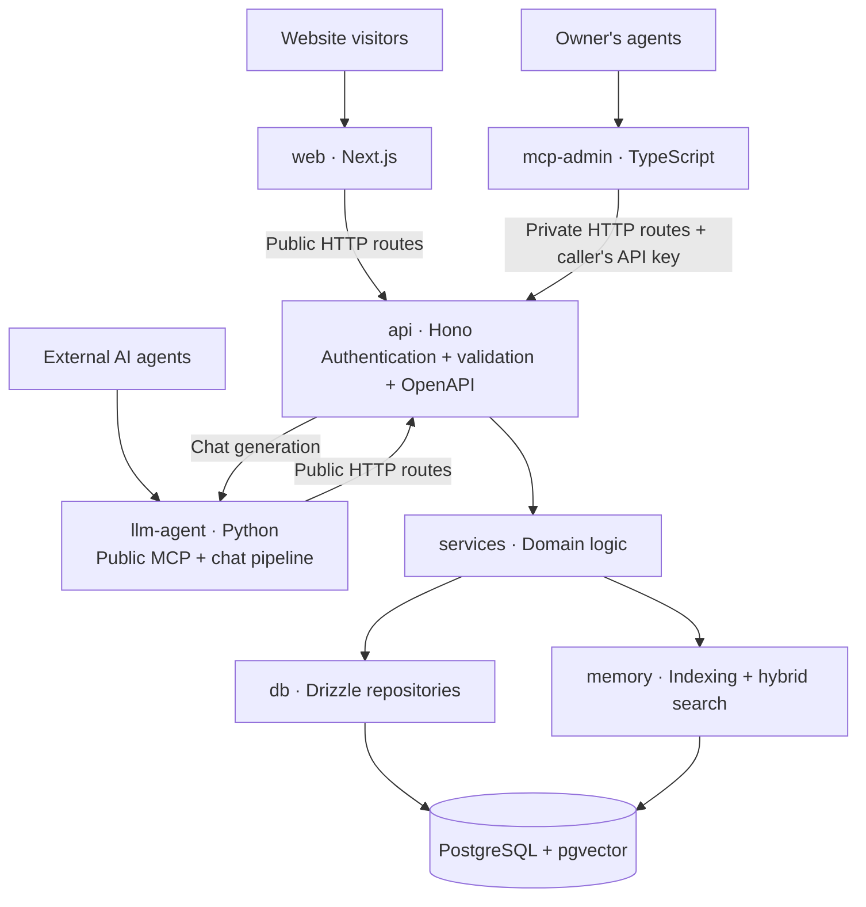

<div align="center">

# sebela.dev

**One profile. A website, a CV, an AI Roadmap — and the tools to ask about all of it.**

The open-source engineering behind Petr Šebela's next professional website.

[](.plan/00-overview/prd.md)
[](LICENSE)

[The idea](#the-idea) · [Architecture](#architecture) · [AI & MCP](#ai--mcp) · [Roadmap](#roadmap) · [Documentation](#documentation)


<sub>A professional profile for people. Structured public knowledge for agents.</sub>

</div>

> [!NOTE]
> **Planning stage.** This checkout contains the specifications, architecture decisions and agent instructions. The applications, runtime tooling and CI described below are planned. The replacement for sebelapetr.cz will launch after all delivery phases are complete.

<details>
<summary><strong>For the owner: replace the preview image</strong></summary>

Add a **1600 × 900 px** PNG or WebP to `docs/images/`, for example `readme-preview.webp`, and update the image path above.

Use a side-by-side capture of the homepage in **light and dark mode**, showing the hero and the beginning of Selected work. Keep the text readable, crop out browser chrome and use the fictional demo profile for a reusable repository screenshot. Follow the monochrome direction in [the design guide](docs/design.md).

The current SVG is an intentional placeholder. Remove this note when the real preview is ready.

</details>

## The idea

A professional website has several readers: clients looking for help, employers evaluating experience, and increasingly AI agents looking for reliable facts. This project gives them different ways into the same structured content.

**Store a fact once. Reuse it everywhere.** PostgreSQL is the canonical source for the website, the CV page, the AI Engineering Roadmap, the assistant and both Model Context Protocol (MCP) servers. Content updates go through the API and appear without a redeploy.

| Surface                    | What it is designed to offer                                                                                                      |
| -------------------------- | --------------------------------------------------------------------------------------------------------------------------------- |
| **Professional website**   | Selected work, experience, services and clear paths for clients and employers.                                                    |
| **CV**                     | A print-friendly page built from the same profile data, alongside a separately prepared and uploaded PDF.                         |
| **AI Engineering Roadmap** | Learning areas, modules, resources, a diary with time tracking, books and events.                                                 |
| **Grounded assistant**     | Questions answered from public profile data, with sources, rich content blocks and an explicit fallback when evidence is missing. |
| **Two MCP servers**        | A public read-only interface for external agents and a secured interface for the owner's content-management agents.               |

The repository is part of the portfolio too: architecture decisions, testing policy and the development workflow are open for inspection.

## Architecture

**The API is the trust boundary.** Every client reaches content through HTTP. Only the API's backend layers access the database.



- **One contract across languages.** OpenAPI drives generated TypeScript and Python clients; Zod provides API validation and shared TypeScript schemas.
- **Authenticated content writes.** Private API routes verify API keys. Keys stay server-side; the public assistant has no content-write credentials or tools.
- **A bounded chat exception.** Public chat routes may create and continue the caller's own conversation. The API checks ownership, limits and budget.
- **Rebuildable retrieval.** The search index is derived from canonical content in PostgreSQL.
- **Content outside git.** Development uses a fictional demo seed. Real profile content is loaded privately and maintained through the API; media lives in object storage.

Read the [architecture](docs/architecture.md), [package boundaries](docs/repository-structure.md) and [decision records](docs/decisions/README.md) for the reasoning and tradeoffs.

### Planned stack

| Area             | Technology                                                          |
| ---------------- | ------------------------------------------------------------------- |
| Workspace        | TypeScript, pnpm workspaces, Turborepo                              |
| Website          | Next.js, Tailwind CSS v4, shadcn/ui on Base UI, Geist, Lucide       |
| API & contracts  | Hono, Zod, OpenAPI, generated clients                               |
| Data & retrieval | PostgreSQL, Drizzle, pgvector, vector similarity + full-text search |
| AI service       | Python, FastAPI, LangGraph                                          |
| Verification     | Vitest, Playwright, promptfoo; Python tooling chosen in phase 7     |
| Observability    | Langfuse for AI traces, cost and scoring                            |
| Delivery         | Docker Compose, GitHub Actions, deployment to a VPS                 |

The visual direction is editorial and monochrome: strong typography, generous whitespace, light and dark themes. See [design](docs/design.md).

## AI & MCP

### How an answer is produced

The browser reaches the assistant through the website and API. The API owns conversations and access controls; the Python service produces answers.

1. **Check access and cost.** The API verifies conversation ownership, applies rate limits and bot checks, and checks the available budget before a model call.
2. **Guard the input.** A small model checks for off-topic requests, manipulation and abuse.
3. **Find evidence.** The generating model chooses structured tools for exact facts and hybrid search for open questions. Both read public data through the API.
4. **Validate and stream.** Deterministic checks validate the output structure, sources, links and exploration status before the answer is streamed through the API to the website.

Answers include typed blocks such as experience, services, roadmap items and sources. Missing evidence leads to an explicit “I don't know” and a contact option. Built, tested and designed work must retain its recorded status.

Langfuse traces the pipeline; stored conversations are scored afterwards. Model and embeddings choices are deferred to their implementation phases and evaluated before adoption.

### Two servers, two responsibilities

|                    | Public MCP                                                                        | Content-management MCP                                    |
| ------------------ | --------------------------------------------------------------------------------- | --------------------------------------------------------- |
| **App**            | `apps/llm-agent`                                                                  | `apps/mcp-admin`                                          |
| **Audience**       | External AI agents                                                                | The owner's agents                                        |
| **Access**         | Public, read-only, rate limited                                                   | Secured; caller's API key forwarded to the API            |
| **Purpose**        | Read profile, experience, services and learning activity; search public knowledge | Add and update content through private API routes         |
| **Implementation** | Python; shares read tools with the chatbot                                        | TypeScript; reuses contracts and the generated API client |

Connection URLs and client configuration will be added when the servers are implemented.

### Retrieval without a separate vector service

Public content is split into chunks, embedded and indexed with pgvector in the same PostgreSQL instance. Search combines vector similarity and full-text matching. Relevance is measured with questions that have known sources, and the index can be rebuilt from the original content.

## Roadmap

The phases organise implementation; they are not separate public releases. Specifications are drafts until approved.

| Phase                       | Deliverable                                                                       | Specification                                                                      |
| --------------------------- | --------------------------------------------------------------------------------- | ---------------------------------------------------------------------------------- |
| **00 · Overview & harness** | Project design, documentation, agent rules and the unattended development harness | [Overview](.plan/00-overview/prd.md) · [Harness](.plan/00-overview/harness-prd.md) |
| **00 · Trial**              | A disposable dry run of the orchestration and review workflow                     | [Trial](.plan/00-trial/prd.md)                                                     |
| **01 · Foundation**         | Monorepo tooling, isolation, guardrails, Docker skeleton and CI                   | [Foundation](.plan/01-foundation/prd.md)                                           |
| **02 · API & database**     | Profile domain, OpenAPI, authentication and fictional demo data                   | [API & database](.plan/02-api-db/prd.md)                                           |
| **03 · Website**            | Presentation pages, CV, design system and a chat UI backed by prepared answers    | [Website](.plan/03-web/prd.md)                                                     |
| **04 · AI Roadmap**         | Learning domain, diary, books, events and roadmap pages                           | [AI Roadmap](.plan/04-ai-roadmap/prd.md)                                           |
| **05 · Admin MCP**          | Secured content-management tools and content skills                               | [Admin MCP](.plan/05-mcp-admin/prd.md)                                             |
| **06 · Retrieval**          | Chunking, embeddings and measured hybrid search                                   | [Retrieval](.plan/06-rag-memory/prd.md)                                            |
| **07 · LLM agent**          | Grounded chatbot, public MCP and conversation controls                            | [LLM agent](.plan/07-llm-agent/prd.md)                                             |
| **08 · Delivery**           | Verified image builds, VPS deployment, backups, rollback and launch               | [Delivery](.plan/08-delivery/prd.md)                                               |

## Working on the project

There is no runnable application in this checkout yet. The workspace, its quality checks and the local database are in place:

- **Prerequisites:** Git, [Node.js](https://nodejs.org/) 26 (LTS; see `.nvmrc`), [pnpm](https://pnpm.io/) 12.21.0, for example `npm install --global pnpm@12.21.0`, and Docker with Compose.
- **Install:** `pnpm install --frozen-lockfile`
- **Infrastructure:** copy `.env.example` to `.env`, set a local `POSTGRES_PASSWORD`, then `docker compose up --detach --wait` starts PostgreSQL with pgvector. Every worktree gets its own database in it.
- **Check:** `pnpm lint`, `pnpm typecheck`, `pnpm test`, `pnpm build` — the same commands CI runs.

Application commands will be documented as the application phases land. Versions and command details: [repository structure](docs/repository-structure.md#toolchain-and-workspace); the database and worktree isolation: [ports and worktree isolation](docs/repository-structure.md#ports-and-worktree-isolation).

Start with [AGENTS.md](AGENTS.md) and the relevant phase specification. Documentation in `docs/` is binding; behaviour and its documentation change together.

### Development with coding agents

The planned workflow keeps each implementation isolated and makes review explicit:

```text
Issue → branch + worktree → implementation → checks → reviewer
      → issue PR → squash merge into phase branch

Completed phase → phase PR → owner review → merge into master
```

| Role                   | Responsibility                                                                                          |
| ---------------------- | ------------------------------------------------------------------------------------------------------- |
| **Orchestrator**       | Pick ready issues, manage worktrees, dispatch agents and integrate reviewed work into the phase branch. |
| **Backend developer**  | Implement the API, data layer, services and contracts.                                                  |
| **Frontend developer** | Implement the website and shared UI; capture visual evidence.                                           |
| **AI developer**       | Implement MCP, retrieval and the Python service, evals-first.                                           |
| **Reviewer**           | Check acceptance criteria, boundaries, security and verification evidence without editing code.         |
| **Docs keeper**        | Keep documentation and agent instructions aligned with implementation.                                  |

The phase loop is designed to process one issue per iteration with a fresh agent context and state held in GitHub. It skips issues requiring human decisions and bounds retries on failing work. **Only the owner merges into `master`.**

See [agent orchestration](docs/agents.md), [permissions](docs/permissions.md) and [git workflow](docs/git-workflow.md).

### Verification policy

- **Test-first:** security, API contracts, services, domain logic and bug fixes. The test must fail before the implementation exists.
- **Visual evidence:** Playwright checks and screenshots at **360, 768 and 1280 px**, in both light and dark mode.
- **Evals-first:** MCP and AI behaviour, including grounding, unknown answers, source correctness and direct and indirect prompt injection. Safety suites must pass completely; other thresholds are set from the baseline and never lowered to pass a run.
- **Merge gate:** lint, typecheck, tests and build. API integration tests use real PostgreSQL and fictional fixtures.

These are the project's acceptance rules; they do not imply the planned checks already exist. Details: [testing policy](docs/testing.md).

## Documentation

| Read this                                                                                            | For                                                    |
| ---------------------------------------------------------------------------------------------------- | ------------------------------------------------------ |
| [Overview PRD](.plan/00-overview/prd.md)                                                             | Product scope, audiences and phase boundaries          |
| [Architecture](docs/architecture.md) · [Decisions](docs/decisions/README.md)                         | Data flow, trust boundary and engineering tradeoffs    |
| [Repository structure](docs/repository-structure.md)                                                 | Target layout, allowed imports and worktree isolation  |
| [Glossary](GLOSSARY.md) · [Domain context](docs/domain-context.md)                                   | Canonical terms, entity relationships and access rules |
| [Design](docs/design.md)                                                                             | Visual direction, themes and responsive requirements   |
| [Code standards](docs/code-standards.md) · [Testing](docs/testing.md)                                | Implementation and verification expectations           |
| [Git workflow](docs/git-workflow.md) · [Agents](docs/agents.md) · [Permissions](docs/permissions.md) | Branches, reviews, roles and automation boundaries     |
| [Release workflow](docs/release-workflow.md)                                                         | Planned deployment, backups and rollback               |

## License

**Source code and the fictional demo seed:** [MIT](LICENSE).

**Personal content, photographs, CV data, project descriptions and branding:** © Petr Šebela. These are not covered by the MIT license. Forking the code does not grant permission to reuse personal content or identity.
